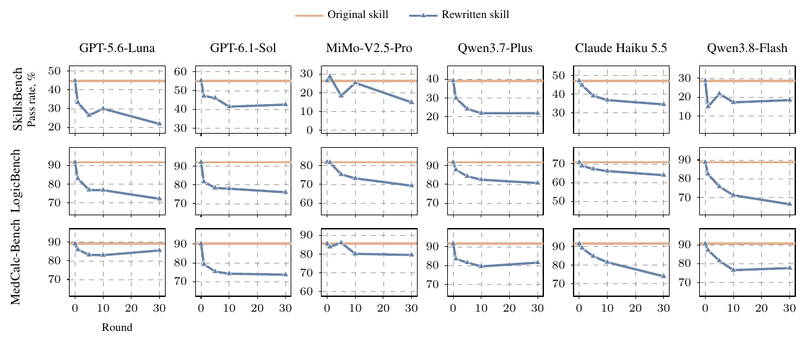
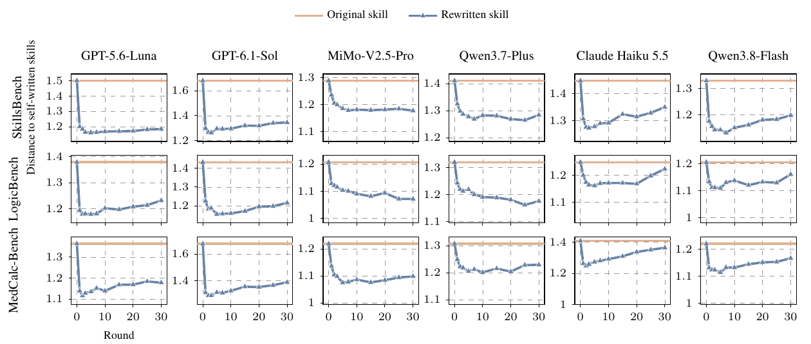
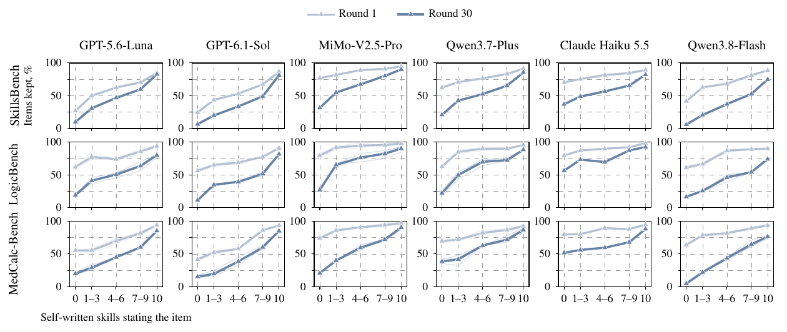
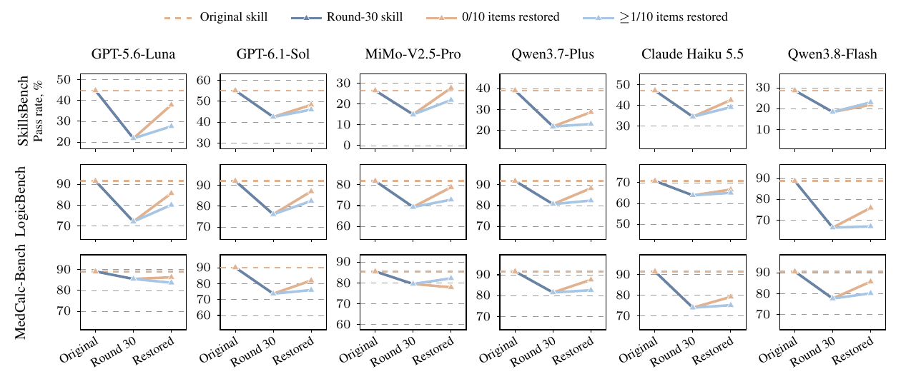

<h1 align="center">How Feedback-Free Self-Evolution Reshapes Agent Skills: A Systematic Study</h1>

<p align="center">
  Litao Guo · Man Chen · Xinli Xu · Jinsong Zhou · Zixin Zhang · Ying-Cong Chen
</p>

<p align="center">
  <a href="#resources"></a>
  <a href="#resources"></a>
  <a href="https://github.com/LitaoGuo/How-Self-Evolution-Reshapes-Skills"></a>
  <a href="LICENSE"></a>
</p>

<p align="center">
  <b>English</b> · <a href="README.zh-CN.md">简体中文</a><br>
  <a href="#introduction">Introduction</a> · <a href="#evaluation">Evaluation</a> · <a href="#skilldiff">SkillDiff</a> · <a href="#resources">Resources</a>
</p>

[](assets/teaser.png)

## Introduction

Agent skills capture expert procedures in reusable documents. We study what happens when a model repeatedly rewrites them without a task, execution outcome, or judgment to guide it. We test **six models over 30 rewriting rounds on three benchmarks**: SkillsBench, LogicBench, and MedCalc-Bench. The same model rewrites and uses each skill.

**Rewriting loses first the content the model rarely writes on its own.** We identify this content using ten skills the model writes from the topic alone. Restoring the lost items recovers much of the lost performance. [**SkillDiff**](#skilldiff) marks these items in the original skill to direct the agent’s attention to them, improving performance without rewriting.

## Evaluation

Each figure pairs a finding with a command to plot the included [curve data](data/curves.csv). The expandable experiment steps use your own skill files and model access; see [experiment setup](EXPERIMENTS.md).

<details>
<summary>Install plotting dependencies</summary>

Use Python 3.10 or later.

```bash
git clone https://github.com/LitaoGuo/How-Self-Evolution-Reshapes-Skills.git
cd How-Self-Evolution-Reshapes-Skills
python3 -m venv .venv
source .venv/bin/activate
python3 -m pip install -r requirements.txt
```

Plotting commands save their figures to `outputs/` and print a numerical summary.

</details>

### Rewriting lowers task performance

After 30 rounds, every model performs worse on every benchmark. The average SkillsBench pass rate falls by **14.6 percentage points**.

[](assets/decline.png)

**Plot the reported curves** · [Open full-size figure](assets/decline.png)

```bash
python3 -m experiments.evaluate \
  performance
```

<details>
<summary>Run the rewriting and task-performance experiment</summary>

Prepare the [original skills, topics, and SkillsBench tasks](EXPERIMENTS.md#data). Generate 30 rewrites, then evaluate the original and rounds 1, 5, 10, and 30. The example uses GPT-5.6-Luna for both rewriting and evaluation.

```bash
python3 -m experiments.generate --skills data/originals --topics data/topics \
  --backend codex --model gpt-5.6-luna --stage chain --out runs/luna
python3 -m experiments.benchmark --tasks-dir skillsbench/tasks \
  --skills data/originals --runs runs/luna --model gpt-5.6-luna \
  --conditions original round-1 round-5 round-10 round-30 --out runs/performance
python3 -m experiments.evaluate performance --scores runs/performance/scores.csv
```

[Generation code](experiments/generate.py) · [Benchmark code](experiments/benchmark.py)

</details>

### Rewrites move toward self-written skills

Ten skills written from the topic alone sample the model’s **prior**: what it writes without the expert’s document. Rewrites move closer to these self-written skills, with most of the decrease in the first five rounds. A normalized TF-IDF distance of **1** means the same separation as between the self-written skills.

[](assets/distance.png)

**Plot the reported curves** · [Open full-size figure](assets/distance.png)

```bash
python3 -m experiments.evaluate \
  distance
```

<details>
<summary>Generate self-written drafts and measure distance</summary>

Use the rewrite chains from the [performance experiment](#rewriting-lowers-task-performance). Generate ten self-written skills with the same model, topic, and length target, then measure the normalized distance.

```bash
python3 -m experiments.generate --skills data/originals --topics data/topics \
  --backend codex --model gpt-5.6-luna --stage drafts --out runs/luna
python3 -m experiments.distance --runs runs/luna --out outputs/distance.json
```

[Distance code](experiments/distance.py)

</details>

### Rewriting loses content outside the prior first

After 30 rounds, retention averages **23.1%** for original items absent from all ten drafts and **84.2%** for items present in all ten, across models and benchmarks.

[](assets/coverage.png)

**Plot the reported curves** · [Open full-size figure](assets/coverage.png)

```bash
python3 -m experiments.evaluate \
  retention
```

<details>
<summary>Judge original items and calculate retention</summary>

Use the rewrite chains and ten self-written skills from the preceding experiments. The judge compares each document with all original items in one call. Retention counts `KEPT` and `REWORDED`, excluding `UNCLEAR`.

```bash
python3 -m experiments.judge --runs runs/luna --backend codex --model gpt-5.6-luna
python3 -m experiments.retention --runs runs/luna --out outputs/retention.json
```

[Item splitting](experiments/items.py) · [Judging](experiments/judge.py) · [Retention](experiments/retention.py)

</details>

### Restoring lost content recovers performance

On SkillsBench, restoring lost items absent from all ten drafts recovers **8.8 percentage points** over round 30, averaged across models. Restoring the other lost items recovers **4.4 points**.

[](assets/restore.png)

**Plot the reported curves** · [Open full-size figure](assets/restore.png)

```bash
python3 -m experiments.evaluate \
  restoration
```

<details>
<summary>Build and evaluate the restored skills</summary>

Start from the round-30 skills and item judgments above. Remove weakened or changed versions of lost items to form a common base. Restore items absent from all ten drafts, the other lost items, or all lost items to produce three versions.

```bash
python3 -m experiments.restore --runs runs/luna --backend codex --model gpt-5.6-luna
python3 -m experiments.benchmark --tasks-dir skillsbench/tasks \
  --skills data/originals --runs runs/luna --model gpt-5.6-luna \
  --conditions original round-30 restored-outside restored-other restored-all \
  --out runs/restoration
python3 -m experiments.evaluate restoration --scores runs/restoration/scores.csv
```

[Restoration code](experiments/restore.py) · [Task-performance analysis](experiments/evaluate.py)

</details>

## SkillDiff

SkillDiff adds **[FOCUS]** tags to original list entries, paragraphs, code blocks, and tables absent from all ten self-written skills. A short note asks the agent to carry their specific procedures into its plan as written. The original wording stays intact, and the average SkillsBench pass rate rises by **4.8 percentage points** over original skills evaluated in the same batch.

**Plot the reported gains**

```bash
python3 -m experiments.evaluate \
  skilldiff
```

<details>
<summary>Mark the original skills and evaluate SkillDiff</summary>

Start from [original skills and topics](EXPERIMENTS.md#data). SkillDiff needs ten self-written skills and their item judgments; it requires no rewrite chain. Evaluate the original and marked skill in the same batch.

```bash
python3 -m experiments.generate --skills data/originals --topics data/topics \
  --backend codex --model gpt-5.6-luna --stage drafts --out runs/luna
python3 -m experiments.judge --runs runs/luna --drafts-only \
  --backend codex --model gpt-5.6-luna
python3 -m experiments.skilldiff --runs runs/luna
python3 -m experiments.benchmark --tasks-dir skillsbench/tasks \
  --skills data/originals --runs runs/luna --model gpt-5.6-luna \
  --conditions original skilldiff --out runs/skilldiff
python3 -m experiments.evaluate skilldiff --scores runs/skilldiff/scores.csv
```

[SkillDiff code](experiments/skilldiff.py)

</details>

## Resources

| Resource | Status |
| --- | --- |
| arXiv paper | Coming soon |
| Hugging Face dataset | Coming soon |
| Figure data | [Main curves and SkillDiff gains](data/curves.csv) |
