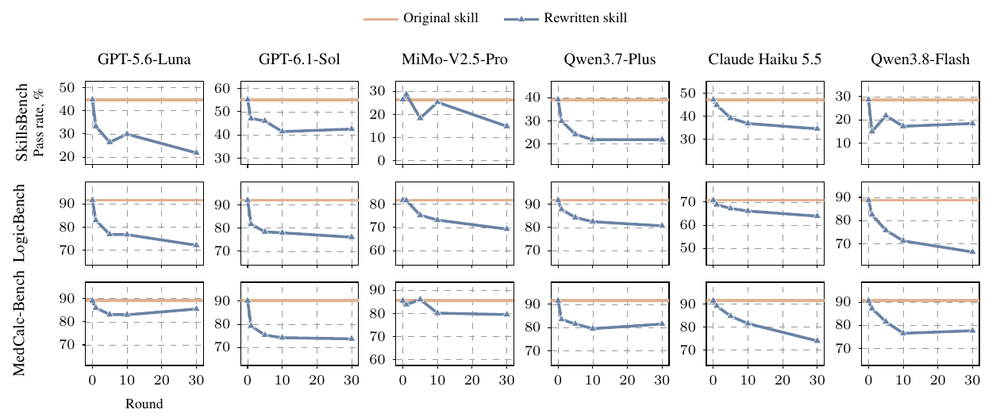
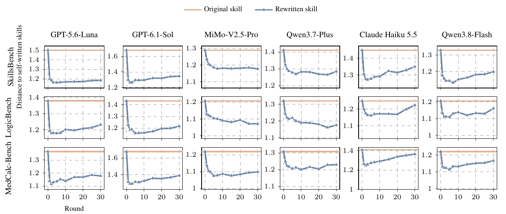
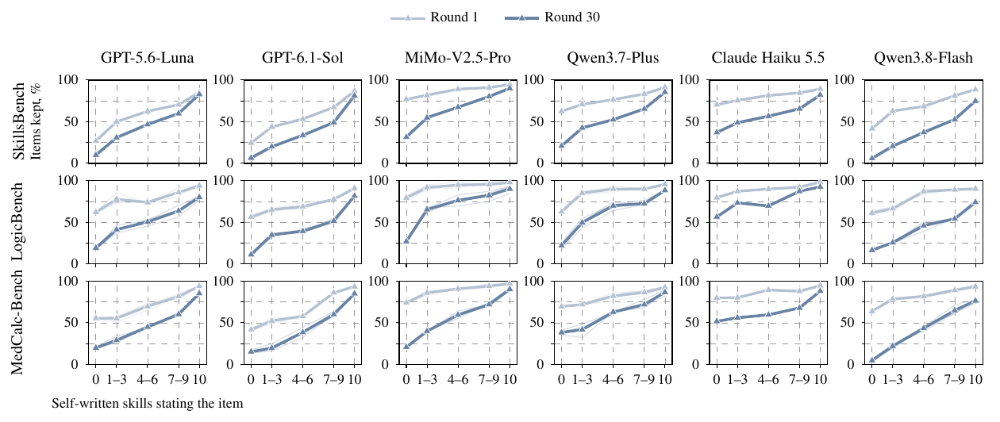
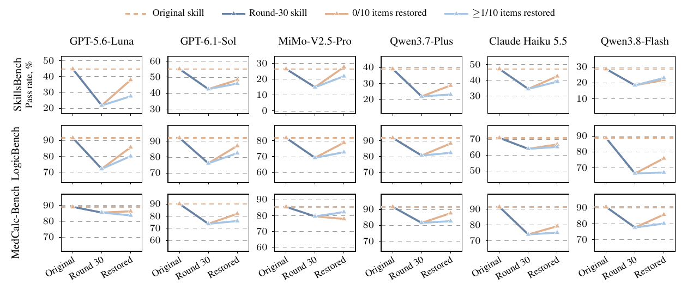

<h1 align="center">无反馈自我演化如何重塑智能体技能：一项系统研究</h1>

<p align="center">
  Litao Guo · Man Chen · Xinli Xu · Jinsong Zhou · Zixin Zhang · Ying-Cong Chen
</p>

<p align="center">
  <a href="#资源"></a>
  <a href="#资源"></a>
  <a href="https://github.com/LitaoGuo/How-Self-Evolution-Reshapes-Skills"></a>
  <a href="LICENSE"></a>
</p>

<p align="center">
  <a href="README.md">English</a> · <b>简体中文</b><br>
  <a href="#研究介绍">研究介绍</a> · <a href="#实验评估">实验评估</a> · <a href="#skilldiff">SkillDiff</a> · <a href="#资源">资源</a>
</p>

[](assets/teaser.png)

## 研究介绍

智能体技能将专家的操作流程写成可复用的文档。我们研究模型在没有任务、执行结果或判读意见引导时，反复改写技能会带来什么变化。实验覆盖 **6 个模型、30 轮改写、3 个基准**：SkillsBench、LogicBench 和 MedCalc-Bench，并由同一模型改写和使用技能。

**改写最先丢失的，是模型自己很少写出的内容。** 我们用模型仅根据主题生成的 10 份自写技能识别这些内容。放回丢失的条目能恢复相当一部分表现。[**SkillDiff**](#skilldiff) 则在原技能中标记这些条目，引导智能体关注它们，无需改写即可提升表现。

## 实验评估

每张图展示一项发现，图下命令使用仓库内的[曲线数据](data/curves.csv) 绘图。展开的实验步骤需要自行准备技能文件和模型访问权限，见[实验准备](EXPERIMENTS.zh-CN.md)。

<details>
<summary>安装绘图依赖</summary>

使用 Python 3.10 或更新版本。

```bash
git clone https://github.com/LitaoGuo/How-Self-Evolution-Reshapes-Skills.git
cd How-Self-Evolution-Reshapes-Skills
python3 -m venv .venv
source .venv/bin/activate
python3 -m pip install -r requirements.txt
```

绘图命令将图片保存到 `outputs/`，并打印数值摘要。

</details>

### 反复改写降低任务表现

30 轮后，六个模型在三个基准上的表现均有下降。SkillsBench 的平均通过率下降 **14.6 个百分点**。

[](assets/decline.png)

**绘制论文曲线** · [打开完整尺寸图片](assets/decline.png)

```bash
python3 -m experiments.evaluate \
  performance
```

<details>
<summary>运行技能改写与任务评测</summary>

准备[原始技能、主题和 SkillsBench 任务](EXPERIMENTS.zh-CN.md#数据)。生成 30 轮改写，再评测原技能与第 1、5、10、30 轮改写稿。示例中，改写与任务评测均使用 GPT-5.6-Luna。

```bash
python3 -m experiments.generate --skills data/originals --topics data/topics \
  --backend codex --model gpt-5.6-luna --stage chain --out runs/luna
python3 -m experiments.benchmark --tasks-dir skillsbench/tasks \
  --skills data/originals --runs runs/luna --model gpt-5.6-luna \
  --conditions original round-1 round-5 round-10 round-30 --out runs/performance
python3 -m experiments.evaluate performance --scores runs/performance/scores.csv
```

[生成代码](experiments/generate.py) · [评测代码](experiments/benchmark.py)

</details>

### 改写稿逐渐靠近模型自写稿

仅根据主题生成的 10 份自写技能，采样了模型的**先验**，即它在没有专家文档时会写出的内容。改写稿逐渐靠近这些自写稿，距离的下降主要发生在前五轮。归一化 TF-IDF 距离为 **1**，表示与自写稿之间的距离相当于自写稿彼此之间的距离。

[](assets/distance.png)

**绘制论文曲线** · [打开完整尺寸图片](assets/distance.png)

```bash
python3 -m experiments.evaluate \
  distance
```

<details>
<summary>生成自写稿并计算距离</summary>

使用[任务表现实验](#反复改写降低任务表现)生成的改写链。以相同模型、主题和目标长度生成 10 份自写技能，再计算归一化距离。

```bash
python3 -m experiments.generate --skills data/originals --topics data/topics \
  --backend codex --model gpt-5.6-luna --stage drafts --out runs/luna
python3 -m experiments.distance --runs runs/luna --out outputs/distance.json
```

[距离分析代码](experiments/distance.py)

</details>

### 改写最先丢失先验之外的内容

在六个模型、三个基准上取平均，30 轮后，10 份自写稿都未覆盖的原始条目保留了 **23.1%**，10 份都覆盖的条目保留了 **84.2%**。

[](assets/coverage.png)

**绘制论文曲线** · [打开完整尺寸图片](assets/coverage.png)

```bash
python3 -m experiments.evaluate \
  retention
```

<details>
<summary>判读原始条目并计算保留率</summary>

使用前面实验生成的改写链与 10 份自写技能。判读模型在一次调用中比较一份文档与原技能的全部条目。`KEPT` 和 `REWORDED` 计为保留，`UNCLEAR` 不计入分母。

```bash
python3 -m experiments.judge --runs runs/luna --backend codex --model gpt-5.6-luna
python3 -m experiments.retention --runs runs/luna --out outputs/retention.json
```

[条目切分](experiments/items.py) · [判读代码](experiments/judge.py) · [保留率计算](experiments/retention.py)

</details>

### 放回丢失内容可以恢复任务表现

在 SkillsBench 上，相比第 30 轮改写稿，放回 10 份自写稿都未覆盖的丢失条目，各模型平均恢复 **8.8 个百分点**。放回其余丢失条目，平均恢复 **4.4 个百分点**。

[](assets/restore.png)

**绘制论文曲线** · [打开完整尺寸图片](assets/restore.png)

```bash
python3 -m experiments.evaluate \
  restoration
```

<details>
<summary>构建恢复版本并评测</summary>

使用前面的第 30 轮改写稿和条目判读结果。先移除丢失条目在改写稿中弱化或改动后的版本，得到共同底稿，再分别放回 10 份自写稿均未覆盖的丢失条目、其余丢失条目，以及全部丢失条目。

```bash
python3 -m experiments.restore --runs runs/luna --backend codex --model gpt-5.6-luna
python3 -m experiments.benchmark --tasks-dir skillsbench/tasks \
  --skills data/originals --runs runs/luna --model gpt-5.6-luna \
  --conditions original round-30 restored-outside restored-other restored-all \
  --out runs/restoration
python3 -m experiments.evaluate restoration --scores runs/restoration/scores.csv
```

[恢复代码](experiments/restore.py) · [任务表现分析](experiments/evaluate.py)

</details>

## SkillDiff

SkillDiff 为原技能中 10 份自写稿均未覆盖的列表项、段落、代码块和表格添加 **[FOCUS]** 标记，并用一段简短提示要求智能体按原文将具体操作流程纳入计划。原有措辞保持不变，SkillsBench 的平均通过率比同批评测的原技能提高 **4.8 个百分点**。

**绘制论文中的提升结果**

```bash
python3 -m experiments.evaluate \
  skilldiff
```

<details>
<summary>标记原技能并评测 SkillDiff</summary>

从[原始技能和主题](EXPERIMENTS.zh-CN.md#数据)开始。SkillDiff 只需要 10 份自写技能及其条目判读，无需生成改写链。原技能与标记版在同一批次评测。

```bash
python3 -m experiments.generate --skills data/originals --topics data/topics \
  --backend codex --model gpt-5.6-luna --stage drafts --out runs/luna
python3 -m experiments.judge --runs runs/luna --drafts-only \
  --backend codex --model gpt-5.6-luna
python3 -m experiments.skilldiff --runs runs/luna
python3 -m experiments.benchmark --tasks-dir skillsbench/tasks \
  --skills data/originals --runs runs/luna --model gpt-5.6-luna \
  --conditions original skilldiff --out runs/skilldiff
python3 -m experiments.evaluate skilldiff --scores runs/skilldiff/scores.csv
```

[SkillDiff 代码](experiments/skilldiff.py)

</details>

## 资源

| 资源 | 状态 |
| --- | --- |
| arXiv 论文 | 待发布 |
| Hugging Face 数据集 | 待发布 |
| 图表数据 | [主要曲线与 SkillDiff 提升数值](data/curves.csv) |
